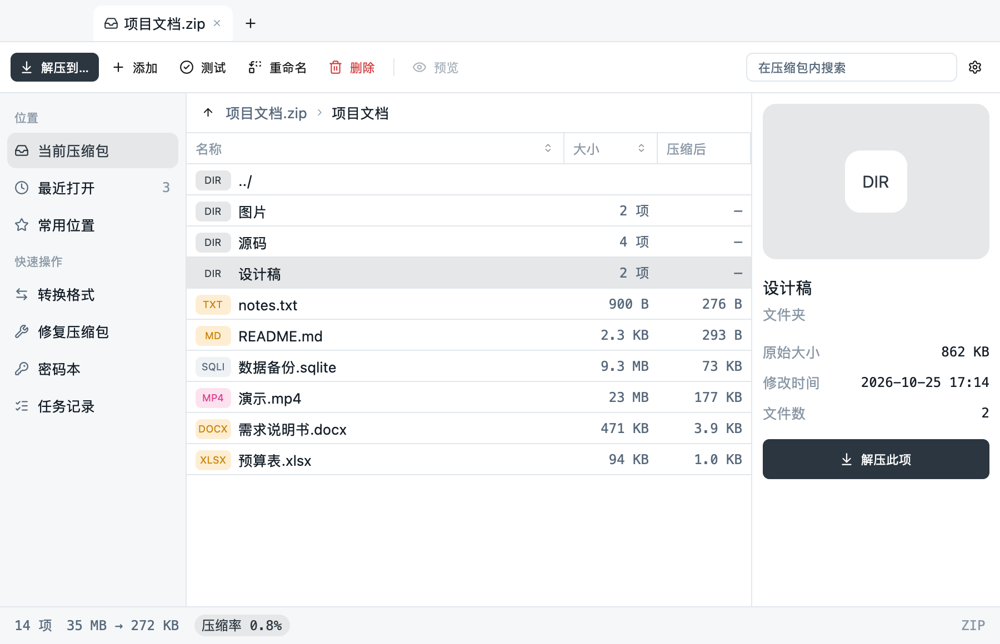
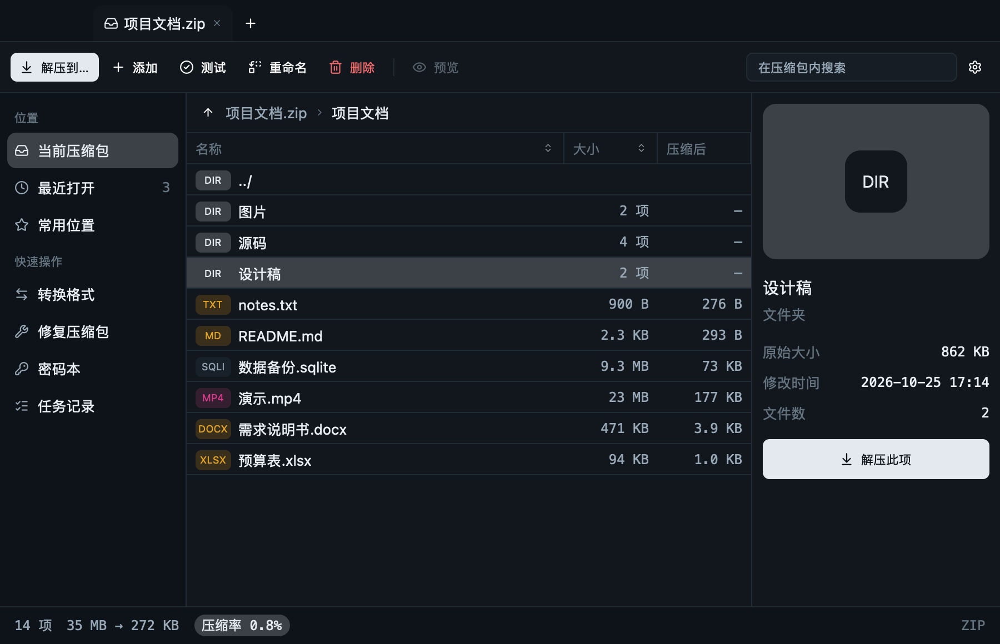
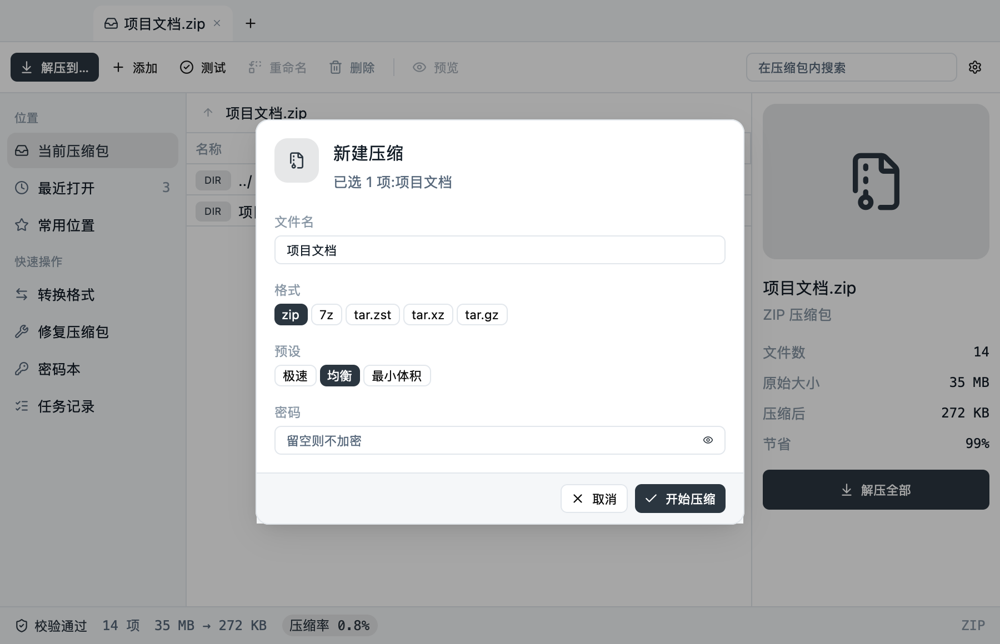
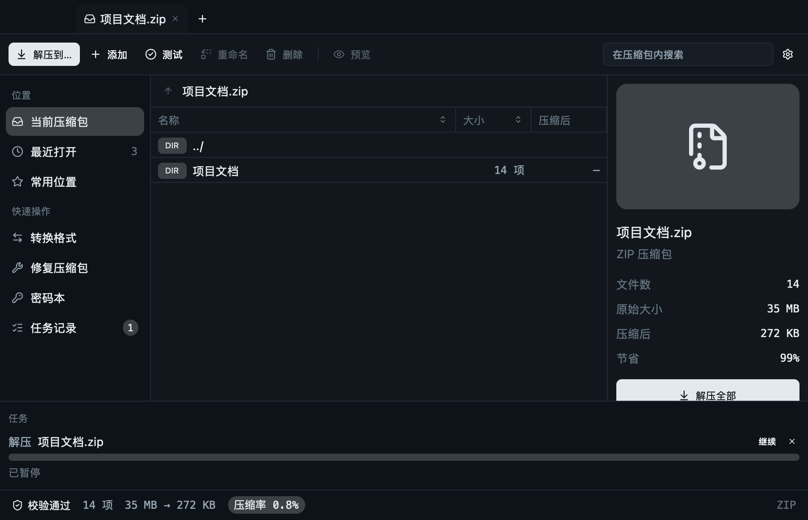
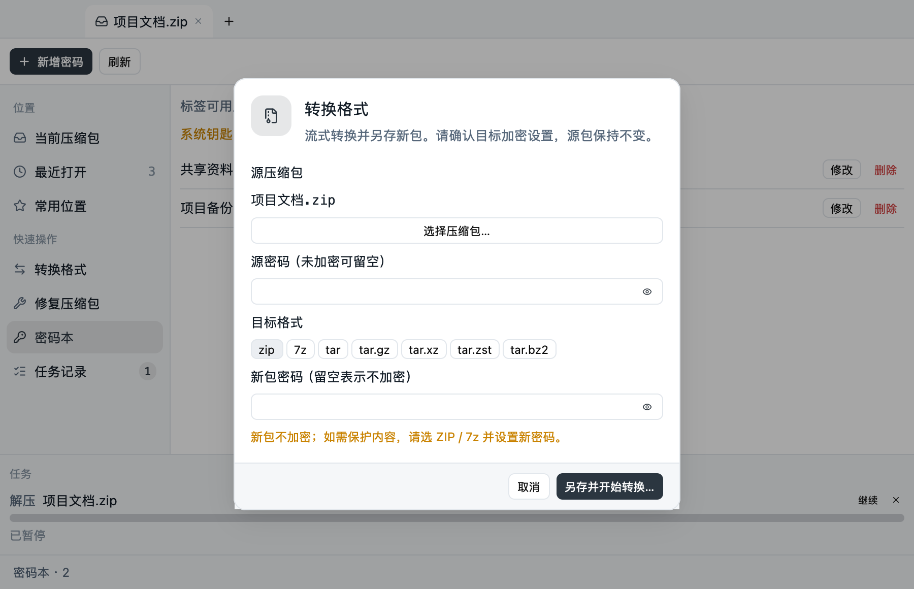
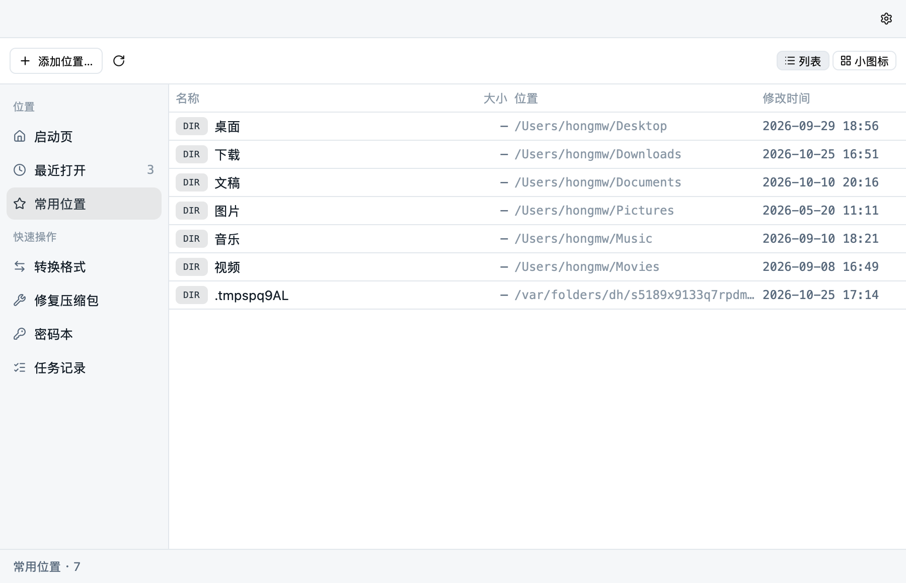

<div align="center">


# RustZIP

**用 Rust 写的跨平台压缩管理软件：快、安全、好看，格式全。**

[](https://github.com/yuhuotech/rustzip/actions/workflows/ci.yml)
[](#开源许可证)
[](https://www.rust-lang.org)


[](#参与贡献)

[特色功能](#特色功能) · [截图](#截图) · [快速开始](#快速开始) · [使用说明](#使用说明) · [开发进度](#开发进度) · [参与贡献](#参与贡献)



</div>

## 项目介绍

RustZIP 是一个用 Rust 开发的压缩管理软件，支持 Windows、macOS 和 Linux。目标是**极致性能、友好体验、简洁美观、功能全面**，基础功能对标 7-Zip，界面则按现代桌面应用的标准来做。

项目包括桌面应用、命令行和官网 / 服务端三部分：

- **桌面应用 `rustzip`**：标签页浏览压缩包、拖拽压缩与解压、任务队列、深浅色主题。
- **命令行 `rz`**：支持创建、列表、解压、校验、转换、修复和文件哈希，适合脚本和服务器。
- **官网与轻量统计接收服务 `web/`**：Next.js 网站和 Vercel API；匿名统计需用户同意后才发送。

桌面应用与命令行共用同一套核心库，行为一致。

> 核心归档能力、CLI 和桌面主流程已经实现；macOS 与 Ubuntu 26.04 已完成一部分实机验证。Windows CI 与安装器自动化验收通过，原生 GUI 人工验收、其他文件管理器集成及正式发布流程仍待完成。**截至 2026-10-29，GitHub Releases 尚无公开版本**；详细状态见[开发计划](docs/next-development-plan.md)和[第二阶段验收](docs/phase-2-platform-acceptance.md)。

## 特色功能

**格式**

- 读写 `zip`（含 AES-256 加密）、`7z`（固实块、LZMA2、AES-256、文件名加密）、`tar` 及 `tar.gz / xz / zst / bz2 / lz4`，以及单文件 `.gz / .xz / .zst / .bz2 / .lz4`。
- 读取按文件头识别，不看扩展名。
- `rar` 只读，不实现压缩，通过默认关闭的可选 feature 提供（见[关于 RAR](#关于-rar)）。

**性能**

- 流式处理，不把整个文件读进内存。
- ZIP 多线程压缩与解压，xz / zstd / 7z 内部多线程，并行度与内存受统一预算约束。
- ZIP 并行压缩时保持条目顺序。

**安全**

- 压缩包里的一切都视为不可信输入：拒绝 `..`、绝对路径、盘符和逃逸的符号链接，不跟随目标里已有的链接。
- 压缩炸弹防护（压缩比、总大小）。
- 原子写入：失败或取消不留下半成品。
- 密码用 `zeroize` 清理，日志不出现密码和完整用户路径。
- 更新包用 Ed25519 验签，绑定版本、平台和哈希，防降级与换包。

**好用**

- **同名从不失败**：解压遇到同名文件或文件夹，已有的不动，新的自动叫 `名称 (1)`、`名称 (2)`；压缩、转换的输出名被占用时同样处理。
- **智能解压**：压缩包有多个顶层项时自动建同名文件夹，不把文件散落到当前目录。
- **完成后定位结果**：解压完成后在文件管理器中打开并选中刚解出的内容。
- **中日韩文件名**：ZIP 自动识别 GBK / Shift-JIS / EUC-KR 等编码，也可手动指定。
- **压缩包内操作**：添加、删除、重命名、选择性解压、预览；改动先在旁边重新打包并校验，通过后才替换，失败原包不动。
- **格式转换与修复**：流式转换为 ZIP / 7z / tar 系八种格式；ZIP / 7z 尽力抢救可读条目并报告跳过项。
- **任务队列与任务记录**：并发、暂停 / 继续 / 取消、速度与剩余时间；结束的任务进入「任务记录」并保存在本地，菜单上有进行中、失败、完成的角标。
- **密码本**：用系统钥匙串保存，只在需要时读取，默认关闭「记住密码」。
- **常用位置**：系统目录加上打开过压缩包的目录，列表与图标两种视图。
- **深浅色主题**跟随系统，主要操作都有快捷键。

**隐私**

- 联网只有两件事，都能在设置里关：从 GitHub Releases 检查更新、向 `web/` 的 Vercel API 发送匿名安装统计。统计只上报匿名 ID、版本、系统、架构和语言，首次启动会告知，设置里可关闭，不收集文件名、路径、内容或使用行为。

## 截图

| 浏览（深色） | 新建压缩 |
|:---:|:---:|
|  |  |
| **任务面板** | **转换格式** |
|  |  |

<p align="center"></p>

> 截图由 `apps/gui/examples/screenshots.rs` 用真实渲染器离屏生成，内容是演示数据，生成方法见[使用说明](#使用说明)。

## 快速开始

目前还没有公开发布的安装包，请从源码构建；`packaging/` 中可以生成各平台安装产物，Linux tarball 已在 Ubuntu 26.04 做过安装验收。需要 Rust 1.93 或更新（仓库里的 `rust-toolchain.toml` 会自动选择）。

```bash
git clone https://github.com/yuhuotech/rustzip.git
cd rustzip

# 桌面应用
cargo run --release -p rustzip-gui
# 直接打开一个压缩包
cargo run --release -p rustzip-gui -- 某个压缩包.zip

# 命令行
cargo run --release -p rz -- l 某个压缩包.zip
```

macOS 的 `.app / .dmg`、Windows 安装脚本和 Linux 压缩包的打包文件在 [`packaging/`](packaging/)，发布流程见 [`docs/release.md`](docs/release.md)。

## 使用说明

### 命令行

```text
	rz a <archive> <path>... [-l 0-9] [-p -|@file] [-t threads] [-v size] [-d size] [-s size|off] 创建
rz l <archive> [-p -|@file]                                    列出内容
rz x <archive> [-o dir] [-p -|@file] [-t threads] [-y|-n]      解压
rz t <archive> [-p -|@file]                                    校验完整性
rz c <archive> <output> [-p -|@file] [-q -|@file]               转换格式
rz r <archive> <output> [-p -|@file] [-q -|@file]               修复 ZIP / 7z
	rz h <file>... [-a sha256|blake3]                              计算 SHA-256 / BLAKE3
```

- 创建的格式由扩展名决定：`.zip .7z .tar .tar.gz .tar.xz .tar.zst .tar.bz2 .tar.lz4`（及 `.tgz .txz .tzst .tbz2`），单文件 `.gz .xz .zst .bz2 .lz4`。LZ4 使用标准 Frame 格式。
- 解压遇到同名默认保留两者并加序号；`-y` 覆盖，`-n` 跳过已有。
- `-e` 指定文件名编码。
- 加密压缩包密码使用 `-p -` 隐藏提示输入，或 `-p @文件路径` 读取该文件的第一行；不接受命令行明文密码。
- 转换和修复中，`-p` 指输入包密码，`-q` 指输出包密码；两者也可用隐藏提示或密码文件提供。
- `-v` 为 ZIP / 7z 设置最大分卷大小，如 `700M` 或 `2G`；留空时创建单文件归档。
- `-d` 为 7z 指定 LZMA2 字典大小；`-s` 指定固实块最大解压大小，`-s 0` 或 `-s off` 为每个文件分别编码。
- 只读长尾格式包括 ISO 9660、CAB、CPIO、AR（DEB 容器）、LHA / LZH、RPM、XAR 和 CHM；CHM 支持浏览、测试和提取。RAR 仅在启用可选 `rar` feature 的构建中可读。WIM、DMG 已按内容识别但暂不支持读取；NSIS 不从普通 `.exe` 扩展名推断。候选审查见 [`docs/phase-3-format-assessment.md`](docs/phase-3-format-assessment.md)。

### 桌面应用

| 操作 | 快捷键（Windows / Linux 为 Ctrl） |
|---|---|
| 打开压缩包 | `⌘O` |
| 新建压缩 | `⌘N` |
| 搜索 | `⌘F` |
| 解压全部 | `⌘E` |
| 关闭标签页 | `⌘W` |
| 常用位置 / 密码本 / 转换格式 / 修复压缩包 | `⌘⇧B` / `⌘⇧P` / `⌘⇧C` / `⌘⇧R` |

也可以把压缩包拖进窗口打开，把普通文件拖进窗口压缩。设置、密码本之外的数据（`settings.json`、`history.json`）保存在系统配置目录，升级覆盖安装不会丢。

### 关于 RAR

RAR 只读，不实现压缩。解压通过 `rz-ffi` 封装 UnRAR 原生数据回调；该实现依赖受许可限制的 UnRAR 源码，故放在默认关闭的 feature 里：

启用可选 RAR feature 时，UnRAR 通过逐块回调工作；解码前检查压缩比，选中条目的临时输出受声明大小和解压总上限控制，未选条目不写临时盘，预览按图片 / 文本大小限额读取。默认构建仍关闭 RAR；实现边界见[决策 D38](docs/decisions.md#d38-rar-解码输出上限与安全预览)。

```bash
cargo build --release --features rar
```

默认桌面安装包不注册 RAR 关联；启用 RAR 的测试包及其关联配置见[本地打包说明](docs/release.md)。

unRAR 是 C++ 代码，处理的是不可信输入；重要场景下建议在受限环境中使用。

### 生成截图

```bash
RZ_SHOT_DIR=/某个文件夹 cargo run --release -p rustzip-gui --example screenshots
```

### 文档

| 文件 | 内容 |
|---|---|
| [`docs/product.md`](docs/product.md) | 功能需求、格式分档、路线图 |
| [`docs/architecture.md`](docs/architecture.md) | 分层、crate 结构、性能与安全设计 |
| [`docs/tech-spec.md`](docs/tech-spec.md) | 代码、性能、安全、测试、提交规范 |
| [`docs/ui-spec.md`](docs/ui-spec.md) | UI 风格、布局、组件、交互 |
| [`docs/decisions.md`](docs/decisions.md) | 已做的决策与理由 |
| [`docs/phase-3-format-assessment.md`](docs/phase-3-format-assessment.md) | WIM、DMG、CHM、NSIS 候选评估与 CHM 接入边界 |
| [`docs/release.md`](docs/release.md) | 签名、更新源、统计服务、发布 |

## 开发进度

下表区分功能实现状态与平台验收状态。详细证据和下一步事项见[开发计划](docs/next-development-plan.md)。

| 能力 | 状态 |
|---|---|
| zip 读写（含 AES-256 加密） | 已完成 |
| 7z 读写（固实块、LZMA2 多线程、AES-256、文件名加密） | 已完成 |
| tar 及 tar.gz / tar.xz / tar.zst / tar.bz2 / tar.lz4 读写 | 已完成 |
| 单文件格式 .gz / .xz / .zst / .bz2 / .lz4 读写 | 已完成 |
| ZIP / 7z 分卷创建与读取（容量可配置、缺卷明确报错） | 本机往返、取消、缺卷、现有卷保护及发布竞态测试通过；Linux 上与 p7zip 26.00 / 26.02 双向互通，Info-ZIP split ZIP 可由 RustZIP 测试和解压；Windows / macOS 常用工具矩阵待验收 |
| rar 只读（可选 feature `rar`，默认关闭） | 已完成 |
| 安全解压（路径穿越、压缩炸弹、符号链接、setuid） | 已完成 |
| 取消、进度回调、原子写入（失败不留半成品） | 已完成 |
| 权限与修改时间保留 | 已完成 |
| zip 多线程压缩 / 解压；ZIP 大条目分块 Deflate；xz / zstd / 7z（LZMA2）内部多线程压缩 | 已完成，本机往返与 Info-ZIP 校验通过 |
| 命令行 `rz a / l / x / t / c / r / h`（含取消、进度、编码和分开的源 / 目标密码入口） | 已完成 |
| zip 中日韩文件名编码自动识别与手动指定 | 已完成 |
| 同名不失败：保留两者并加序号（解压、压缩、转换、修复输出） | 已完成 |
| 任务队列：并发上限、暂停 / 继续 / 取消、速度与剩余时间、密码失败后重试 | 已完成（`rz-app`） |
| 任务记录：本地保存、菜单角标（进行中 / 失败 / 完成） | 已完成 |
| 全局提示（Toast）与面向用户的打开失败说明 | 已完成 |
| 设置：原子保存、损坏自动隔离、范围校验、各系统配置目录 | 已完成（`rz-app`） |
| 智能解压 | 已完成（`rz-app`） |
| 选择性解压（按文件或文件夹，各格式含固实块与并行路径） | 已完成 |
| 压缩包内添加 / 删除 / 重命名（zip、7z、tar 系列，校验后整体替换） | 已完成（`rz-app::modify`）；符合条件的 ZIP 编辑可复用未改动压缩数据并保留注释和扩展字段，其余情况完整重打包，真正原地增量改写未做 |
| 预览 | 图片在详情栏显示；64 KiB 内白名单 UTF-8 纯文本可预览；7z / tar 的顺序预览使用有限读取；启用可选 RAR feature 时也按调用方大小上限读取；PDF / 音视频交给系统程序打开 |
| 格式转换（ZIP / 7z / tar 系八种目标，独立源 / 目标密码，校验后另存） | 已完成，符号链接暂不支持 |
| ZIP / 7z 修复（尽力抢救可读条目并报告跳过项） | 已完成，严重损坏不保证恢复 |
| 密码本（系统钥匙串；「记住密码」默认关闭） | 已实现；macOS 和 Ubuntu 已通过隔离测试条目的真实钥匙串读写，Windows 待验收 |
| 常用位置（系统目录 + 自动记录；列表 / 小图标视图） | 已完成 |
| 压缩包浏览模型（目录树、自然排序、搜索、面包屑、体积统计） | 已完成（`rz-app`） |
| 更新校验（Ed25519，绑定版本 / 平台 / 哈希） | 已完成，界面已接入，更新源为 GitHub Release；系统安装器启动失败时保留重试入口，待实机验证 |
| 匿名安装统计（激活 + 每日心跳，可关闭） | 客户端已完成；接收服务见 [`web/`](web/) 和 [`web/README.md`](web/README.md)，发布前设置 `RZ_STATS_URL` |
| 发布工具（生成签名密钥、给安装包签名、生成 `update.json`） | 已完成（`rz-release`） |
| 桌面应用 `rustzip`（GPUI Kit） | macOS Metal 渲染与 Ubuntu 26.04 GNOME Wayland / Xvfb 启动通过；Ubuntu 和 macOS 的工作区测试通过；Windows 原生 GUI 尚未验收。侧栏工具范围见 `docs/sidebar-implementation.md` |
| 多语言界面 | 十种语言、365 个资源键已完成；系统语言识别、菜单切换和侧栏布局在 macOS / Ubuntu 26.04 通过；Windows 语言 API、屏幕阅读器和阿拉伯语 RTL 整页布局待设备验收 |
| 应用图标与打包 | macOS `.app` / DMG 已签名并启动，尚未公证；Ubuntu x86_64 Linux tarball 构建、隔离安装和卸载通过；Windows runner 已通过安装器编译、安装 / 卸载冒烟；完整 release 流程尚未运行 |
| 文件关联与右键菜单 | macOS 支持“打开方式”，新增的长尾格式关联待实机验收，Finder 右键 / Quick Look 未做；Nautilus 50.2.2 的 Scripts 菜单、压缩入口和逐字节解压在 Ubuntu 26.04 / Xvfb 验收；Dolphin / Nemo 菜单已打包但未点击验收；Windows 注册表入口未实机验收 |
| 7z 分块并行解压 | 已接入独立固实块调度，支持选择性解压和加密；线程数受解码器字典估算及内存预算限制，其他编码方法回退顺序解压；更大样本和跨平台验收待完成 |
| bzip2 多线程压缩 / 解压 | 单文件及 tar.bz2 按数据块并行压缩；bzip2 单流和串接 member 并行解压；线程数按内存预算估算，预算不足时顺序回退 |
| 大文件分块 Deflate | `.gz` / `.tar.gz` 使用标准串接 gzip member；ZIP 大条目按 900,000 字节分块并行 Deflate，按顺序合并，受内存预算限制；加密 ZIP 和低预算情况顺序回退 |
| 7z 高级压缩参数 | 字典大小、固实块大小和非固实模式已接入 CLI / GUI，并按内存预算限制并行度 |
| 压缩预设 | 极速 / 均衡 / 最小体积 / 邮件分享 / 跨平台兼容已接入；邮件分享默认 20 MiB ZIP / 7z 分卷 |
| 重复文件检测 | GUI 压缩前按内容哈希提示重复，可取消或继续；不自动删除文件 |
| 只读长尾格式 | ISO 9660、CAB、CPIO、AR、LHA / LZH、RPM、XAR、CHM 已接入；DEB 作为 AR 容器读取；WIM、DMG 仅识别并明确不支持；NSIS 尚未识别或读取 |
| 任务完成动作与通知 | 可选择解压完成后显示目录；系统通知默认关闭；Ubuntu GNOME 通知开启 / 关闭行为已验收，macOS 已修复系统应用选择弹窗但实际投递未确认，Windows 待验收 |

## 参与贡献

欢迎提 Issue 和 PR。动手前请先读：

- [`AGENTS.md`](AGENTS.md)：核心规则（范围、许可证、架构、代码质量、性能、安全、测试、UI、隐私）。
- [`docs/tech-spec.md`](docs/tech-spec.md) 与 [`docs/decisions.md`](docs/decisions.md)：规范与已定决策，不要在没有新增决策的情况下改动。

提交前请确认：

```bash
cargo fmt --all --check
cargo clippy --workspace --all-targets --all-features -- -D warnings
cargo test --workspace --all-features
cargo bench -p rz-engine      # 改动压缩 / 解压路径后
```

引入新依赖前请确认许可证：禁止 GPL / AGPL / LGPL 的静态链接依赖。

## 开源许可证

本项目采用 **MIT OR Apache-2.0** 双重许可，你可以任选其一。

启用 `rar` feature 的构建还需遵守 unRAR 的许可条款。第三方图标来自 Lucide（ISC 许可证），详见 [`docs/decisions.md`](docs/decisions.md)。
